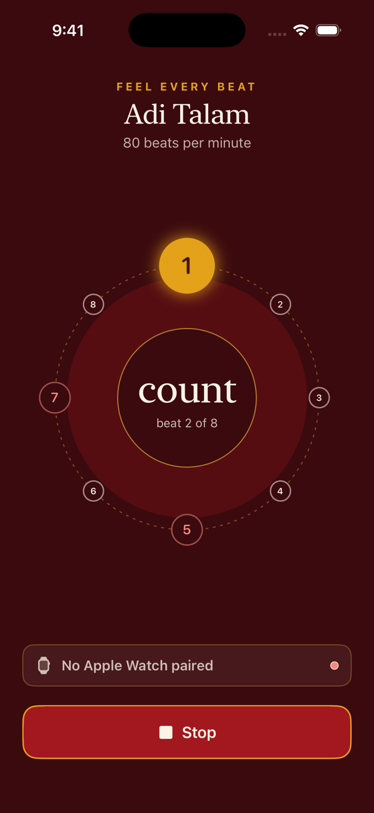
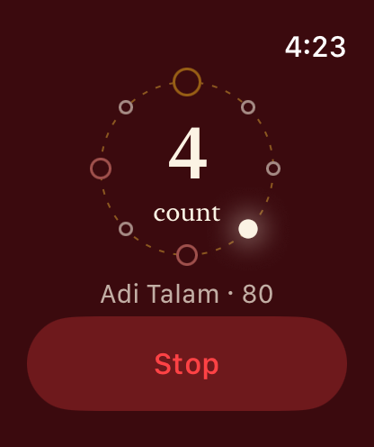

# Thalam 🪘

**Feel the rhythm you can't hear.** Thalam helps deaf Bharatanatyam dancers feel the
*tala* (rhythmic cycle) as taps on the wrist. Pick a tala and tempo on the iPhone, press
Start, and the Apple Watch taps every beat, each kind of beat with its own feel.

> Built at a hackathon by **Neeti Soni** and **[Eshan Shuman](https://github.com/eshanshuman)**.
> This is my copy of the project. After the hackathon I kept working on it: the count-in
> before sam, the CI pipeline that builds and tests both apps on a cloud Mac and publishes
> screenshots, the no-Homebrew build script, and the setup screen layout.

<p align="center">
  
  &nbsp;&nbsp;&nbsp;
  
</p>

## Highlights

- **Drift-free sync between two devices:** the phone sends one start time and both devices work out every beat from it, so Bluetooth lag can never make a tap late
- **A different haptic for each kind of beat** (sam, clap, count/wave), so the dancer can feel where they are in the cycle without looking
- **Keeps tapping with the wrist down** by running a workout session while playing
- **4 Carnatic talas**, 40–160 BPM, with a two-tap count-in
- **Works with no Watch** too ("armband mode" taps on the iPhone using Core Haptics)
- **CI on a GitHub-hosted Mac:** every push builds both apps, runs unit tests on the simulator and saves screenshots

## Tech stack

Swift · SwiftUI · watchOS · WatchConnectivity · Core Haptics · HealthKit (`HKWorkoutSession`) ·
XcodeGen · XCTest · GitHub Actions

| Beat | Meaning | Watch haptic | Colour |
|---|---|---|---|
| **Sam** (beat 1) | start of the cycle | strongest: `.notification` + gold flash | turmeric |
| **Clap** | hand clap | medium: `.directionUp` | coral |
| count / wave | finger count or wave | light: `.click` | ivory |

Talas: **Adi** (8) `S c c c C w C w` · **Rupaka** (3) `S C c` · **Misra Chapu** (7)
`S c c C c C c` · **Khanda Chapu** (5) `S c C C c`. Tempo 40–160 BPM (default 80).

## How it works: "schedule, don't stream"

The iPhone never sends a message per beat. On Start it sends **one** message:

```
{ command: "start", tala: "adi", bpm: 80, startAt: now + 1.5 s + 2 beats }
```

**Count-in:** before the first sam, both devices give two "get ready" taps one beat apart
(beats -2 and -1, a crisp tap that feels unlike any beat; the screens show **2**, **1**),
so the dancer comes in exactly on sam. The first count-in tap lands 1.5 s after Start.

Both devices then compute every beat themselves with the same formula:

```
time of beat n = startAt + n × (60 / bpm)
```

The Watch fires each tap locally at that exact time, so a slow Bluetooth message can
never make a tap late. The iPhone's beat ring uses the same formula, so it stays in step.
Timers are re-armed for each beat against the absolute time (not a repeating timer),
so errors never add up, even after many minutes.

* **Wrist down:** the Watch starts a workout session (`HKWorkoutSession`) while playing.
  That is Apple's way to keep an app running when the screen is off. Nothing is saved to Health.
* **Stop on either device stops both.** Either side can send `start` / `stop`.
* **Messages:** `sendMessage` when the other app is reachable, and always
  `updateApplicationContext` as a "mailbox" fallback, so a Watch app opened late still
  joins in, in step.
* **Watch app closed?** The iPhone wakes it with `HKHealthStore.startWatchApp`.
* **Phone link fails?** On the Watch, tap **Adi · 80 BPM** to play standalone.
* **No watch?** Turn on *Also tap on this iPhone* (armband mode, Core Haptics).

## Project layout

```
project.yml            XcodeGen project (generates Thalam.xcodeproj)
build.sh               Mac: install XcodeGen, generate, build both targets
Shared/                compiled into BOTH apps
  Tala.swift           beat kinds, the 4 talas, tempo limits
  BeatClock.swift      the startAt maths
  BeatScheduler.swift  fires a callback exactly on each beat (no drift)
  ThalamCommand.swift  the start / stop messages
  BeatRingView.swift   circle of beat dots
  Palette.swift        colours
iOS/                   iPhone app: practice screen, beat ring, WatchConnectivity, armband haptics
Watch/                 Watch app: beat engine + haptics, workout session, screens
tools/make_icon.py     draws the app icon
Tests/                 14 unit tests (beat maths, talas, messages, drift-free scheduler)
docs/                  install guide, demo script, screenshots
.github/workflows/     cloud build on a GitHub Mac (no Mac needed to check it compiles)
```

## Build

**Without a Mac:** every push to GitHub builds both apps on a GitHub-hosted Mac
(*Actions* tab). The run also produces `.ipa` files under **Artifacts**.

**On a Mac** (Xcode 15 or newer):

```bash
./build.sh --open   # generate Thalam.xcodeproj and open it in Xcode
./build.sh          # generate, then build both apps for the Simulator
```

If XcodeGen is missing, the script downloads it into `./tools` (no Homebrew or password needed).


## Install and demo

To run it on a real iPhone and Apple Watch, and for the 60-second demo script and troubleshooting, see **[docs/INSTALL.md](docs/INSTALL.md)**.
